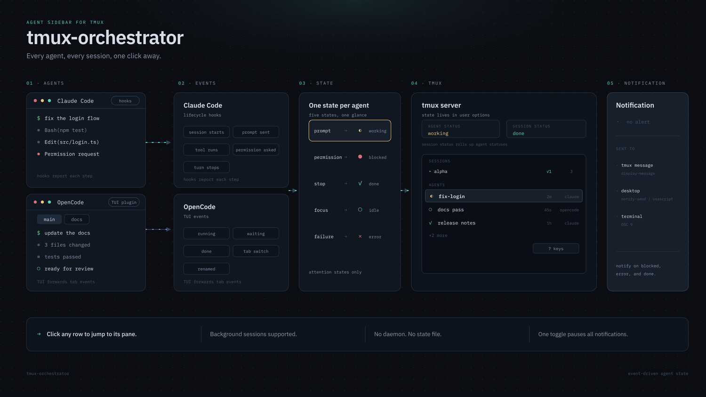

# tmux-orchestrator

A tmux-native sidebar for Claude Code and OpenCode agents. It shows every tmux
session with an agent, the agents in the current session, and switches to the
right session, window, and pane with one click.

State comes from agent lifecycle events, not from screen scraping. The reporter
stores it in tmux pane and session options, so there is no daemon, no state file,
and no external database.

[](docs/diagrams/architecture.gif)

## Requirements

- tmux 3.9 or newer (`side-status` is required).
- `jq` for Claude Code hook payloads.
- Claude Code 2.1.x and/or OpenCode 2.x (tested with 2.1.3). OpenCode 1.x is not
  supported.
- `python3` or `nc` with `-U` support, to focus an OpenCode tab from the
  sidebar.
- Optional desktop notifications: `notify-send` on Linux or `osascript` on macOS.

The plugin checks for `side-status` and refuses to enable the sidebar on older
tmux builds. Nothing else in the tmux configuration is prevented from loading.

## Install

All installation is user-level. No existing hook JSON or agent configuration
file is rewritten.

### tmux

Install with [TPM](https://github.com/tmux-plugins/tpm). Add the plugin to your
tmux configuration, then press `prefix + I`:

```tmux
set -g @plugin 'grota/tmux-orchestrator'
```

Set every `@tmux-orchestrator-*` option above the line that runs TPM
(`run '~/.tmux/plugins/tpm/tpm'`). TPM loads the plugin on that line, and the
plugin ignores options set after it.

`prefix + U` updates it. The tmux plugin holds the only copy of the reporter and
publishes its path in the global option `@tmux-orchestrator-reporter`. The
Claude Code and OpenCode adapters find the reporter there.

### Claude Code

Add this repository as a marketplace and install the plugin:

```text
/plugin marketplace add grota/tmux-orchestrator
/plugin install tmux-orchestrator@tmux-orchestrator
```

Enable it in the `/plugin` interface if it is not enabled already. The sidebar
tracks Claude Code sessions started afterwards.

### OpenCode

The tmux plugin links the OpenCode adapter automatically when OpenCode is
installed, and keeps the link pointing at the loaded copy, so updating the tmux
plugin updates the adapter. Restart OpenCode after the first install. To turn
this off, set the option above the TPM `run` line:

```tmux
set -g @tmux-orchestrator-opencode-auto-install off
```

## Sidebar

By default the sidebar is on the left and 28 columns wide. Configure it before
the plugin loads:

```tmux
set -g @tmux-orchestrator-side right
set -g @tmux-orchestrator-width 32
set -g @tmux-orchestrator-toggle-key S
```

`@tmux-orchestrator-side` accepts `left` or `right`. The toggle key shows and
hides the sidebar; it defaults to `O`, so `prefix + O`. The plugin binds it
only if the key is free in the prefix table or already holds the plugin's
toggle. Otherwise it keeps your binding and shows a message. Changing the key
and reloading removes the plugin's binding from the old key. The enabled state
is persisted in `@tmux-orchestrator-enabled`, so reloading tmux does not bring
back a sidebar that was toggled off.

Drag the sidebar border to resize it. Double-click the border to reset the width
to `@tmux-orchestrator-width`. State refreshes do not reset a width changed by
dragging.

Rows:

- A session row shows the rollup icon, session name, how many agents are
  blocked (`●2`), in error (`×1`) or done (`✓1`), and the agent count. The
  current session is marked with `▸`.
- An agent shows the state icon and the agent name, then a grey line with the
  kind (`claude` or `opencode`) and, right-aligned, how long the agent has been
  in that state (`45s`, `3m12s`, `1h4m`). `set -g @tmux-orchestrator-time off`
  hides the time at once, with no reload.
- Long names wrap over up to four lines, indented under the first one, and the
  fourth ends in `…` if the name still does not fit. Wrapping follows the
  sidebar width, including a dragged border.
  `@tmux-orchestrator-name-max-chars` changes this at once, with no reload:
  `wrap` (the default), `nowrap` for one line cut to the width, or a number
  such as `20` for one line of at most that many characters.
- The focused agent, the one in the pane you are viewing (for OpenCode, its
  active tab), has its name underlined.
  `@tmux-orchestrator-focus-style` changes this at once, with no reload:
  `underlined` (the default), `bold`, or `none`.
- While a Claude Code agent has subagents, its row shows two icons: its main
  thread's state, then the most urgent state among its subagents and how many
  are running, as in `✓ ◐2`. The name gives those columns up.
- A Claude Code pane has one agent row. An OpenCode pane has one row per tab, in
  tab order.
- A pane shows at most nine agent rows. Further agents collapse into one
  `+N more` row whose icon is the most urgent state among them.
- Clicking a session row switches the client to that session. Clicking an agent
  row switches to its session, selects its window, and focuses its exact pane.
  For an OpenCode row it also focuses that tab. Clicking `+N more` selects the
  pane.
- Double-clicking a session row opens a prompt to rename that tmux session.
  Double-clicking an agent row renames the agent in Claude Code or OpenCode, so
  other agents and `claude agents` see the new name too. If the agent does not
  confirm the rename, tmux shows why and the name stays as it was.
- When there are more rows than fit, the list keeps the focused agent's row
  visible. It may trim session rows first, and it does not scroll the terminal.

The last row, `? keys`, opens and closes the keys panel for every client. The
panel lists the toggle key and every key binding whose command calls the
reporter, such as the pause bindings under
[Pause and resume](#pause-and-resume). It reads them when it opens, so bindings
added later appear the next time.

The plugin rebinds `MouseDown1Status` and `DoubleClick1Status` to handle these
clicks, which replaces any existing bindings for them.

### State icons

| State   | Icon | Colour |
| ------- | ---- | ------ |
| working | `◐`  | yellow |
| blocked | `●`  | red    |
| error   | `×`  | red    |
| done    | `✓`  | teal   |
| idle    | `○`  | green  |
| unknown | `·`  | grey   |

Session rollups use the priority `blocked > error > done > working > idle >
unknown`. `done` clears when the agent pane is focused. `error` stays until the
next activity event.

## Notifications

Notifications are sent for transitions into `blocked`, `error`, and `done`.
They are not sent for `working`, `idle`, `unknown`, repeated states, focus
clearing, or agent removal.

Each notification channel has its own option, `on` or `off`:

```tmux
set -g @tmux-orchestrator-notify-tmux on
set -g @tmux-orchestrator-notify-desktop on
set -g @tmux-orchestrator-notify-terminal off
```

- `@tmux-orchestrator-notify-tmux` (default `on`): a message on tmux clients.
- `@tmux-orchestrator-notify-desktop` (default `on`): `notify-send` on Linux or
  `osascript` on macOS. Does nothing if neither command exists.
- `@tmux-orchestrator-notify-terminal` (default `off`): an OSC 9 escape sequence
  written to the terminal of the most recently active client. The terminal
  emulator shows it (Ghostty, iTerm2, WezTerm, Windows Terminal), which also
  works over SSH. It is off by default because those terminals turn it into a
  system notification, so with the desktop channel on you would see each one
  twice.

Set all three to `off` to stop notifications. State tracking continues.

Notification text is:

```text
● fix-login blocked
● Agent blocked: fix-login
```

Kind and tmux location are deliberately omitted. A client that is viewing the
agent's pane (and, for OpenCode, its active tab) does not receive the tmux message, and desktop and terminal notifications
are skipped when any attached client is viewing it. A two-second per-agent cooldown
applies to tmux `done` messages; `blocked` and `error` bypass it. Desktop and
terminal notifications have no cooldown.

To stop notifications for a while without changing these options, see
[Pause and resume](#pause-and-resume).

## Claude Code events

The plugin forwards these hooks to the reporter, which maps them:

| Event                                                  | State                               |
| ------------------------------------------------------ | ----------------------------------- |
| `SessionStart`                                         | `idle`                              |
| `UserPromptSubmit`, `PostToolUse`, `ElicitationResult` | `working`                           |
| `PreToolUse`                                           | `working`                           |
| `PreToolUse` for `AskUserQuestion` or `ExitPlanMode`   | `blocked`                           |
| `PermissionRequest`, `Elicitation`                     | `blocked`                           |
| `Stop`                                                 | `done` after work, otherwise `idle` |
| `StopFailure`                                          | `error`                             |
| interrupt (Esc), read from the session status          | `idle`                              |
| `SubagentStart`                                        | lists the subagent                  |
| `SessionEnd`                                           | removed                             |

Subagent tool calls and permission requests count toward the main agent. A
subagent never starts, completes or ends it. While the main agent or a subagent
waits for the user, the agent stays `blocked` until that same one calls a tool
again, a subagent that waits ends (`SubagentStop`), or a new turn starts.
`PostToolUseFailure` is not treated as an agent error; it only ends that one's
wait. Parallel tool calls of the same agent cannot be told apart, so one of them
finishing clears a wait raised by another. A `Stop` after an `error` keeps `error` until new activity.

The sidebar also lists each subagent, from its first event until its
`SubagentStop`, with its own state. An interrupt drops the list, a background
subagent comes back with its next event, and one silent for 30 minutes is
dropped. When the last subagent ends, the agent takes its main thread's state, so
a background subagent finishing after its main thread does not leave the agent
`working`.

Claude Code sends no hook when you interrupt a turn with Esc. While a turn runs,
a background watcher reads the session's status from Claude Code's session
registry every 2 seconds. When the session is `idle` twice in a row and no `Stop`
arrived, the agent moves to `idle`. The watcher stops when the turn ends, when
the next prompt starts a new one, or when the session exits. It relies on the
registry file, which Claude Code does not document (ADR-0010).

The last hook received is stored in the pane option `@agent_1_event`, for
example `claude:StopFailure:rate_limit`.

The session title is used when the hook provides one. Otherwise the reporter
uses the working-directory basename immediately and asynchronously refreshes the
name from `claude agents --json` on `SessionStart` and `UserPromptSubmit`.
If the lookup is slow or fails, the fallback name remains.

### Background sessions

A background session shown in a pane with `claude attach <id|name>` is that
pane's agent. Its hooks run outside tmux, so the reporter finds the pane whose
`claude attach` argument matches the session: the start of its id, or part of
its name when only one session's name contains it. Selecting the pane right
after attaching adds the row with the state Claude Code reports. The row is
removed once the pane stops showing the session (exit, `←` to the agent view,
or `Ctrl+Z`). Events from a session that no pane shows are ignored and send no
notification.

## OpenCode events

The adapter runs in the OpenCode TUI and reports each open tab as its own agent.
It forwards these events to the reporter, which maps them:

- `session.execution.started`, `permission.replied`, `form.replied` and
  `form.cancelled` to `working`.
- `permission.asked` and `form.created` to `blocked`.
- `session.execution.succeeded` to `done` after work, otherwise to `idle`.
- `session.execution.failed` to `error`.
- `session.execution.interrupted` to `idle`.
- `session.renamed` to a new agent name.

Other events, such as streamed text, stay in the TUI.

Opening a tab adds an agent: `working` if the session is running, `blocked` if
it has a pending permission or form, and `idle` otherwise. Closing a tab removes
that agent without deleting its session. Exiting the TUI removes all of the
pane's agents. With tabs disabled, the session the TUI shows is the pane's only
agent.

Subagents run as child sessions and count toward their root tab. A child asking
for permission or input blocks the root. A child finishing, failing or being
interrupted does not end the root's turn.

A completion after `session.execution.failed` keeps `error` until new activity.
The tab's session title is the agent name. Without a title, the working-directory
basename is used.

Clicking a tab's row focuses that tab, and double-clicking it renames the tab's
session. The reporter sends these requests over a Unix socket that the TUI opens
in `tmux-orchestrator-<uid>/` under `$XDG_RUNTIME_DIR`, or under the system
temporary directory when it is unset.

## Optional command line commands

The plugin runs the reporter for you. These commands are for scripts, custom
bindings, and recovery.

The shell examples in this README call the reporter `tmux-orchestrator`. To run
them as written, define an alias:

```sh
alias tmux-orchestrator="$(tmux show-options -gv @tmux-orchestrator-reporter)"
```

### Pause and resume

Pause is global and indefinite. It suppresses every channel while states keep
updating and the sidebar keeps rendering. There is no default pause key and no
pause indicator in the sidebar.

```sh
tmux-orchestrator notify pause
tmux-orchestrator notify resume
tmux-orchestrator notify toggle
tmux-orchestrator notify status
```

`notify toggle` flips between the two.

Example tmux bindings:

```tmux
bind-key N run-shell -b '#{@tmux-orchestrator-reporter} notify pause'
bind-key M run-shell -b '#{@tmux-orchestrator-reporter} notify resume'
```

Pause survives plugin reloads and client detach because it is a tmux option.
`notify status` reports the pause state, each channel's setting, and whether a
desktop command is available.

### Maintenance

Recompute every session summary after an unexpected shutdown or stale state:

```sh
tmux-orchestrator reconcile
```

Remove state from panes whose process has exited (for `remain-on-exit` panes):

```sh
tmux-orchestrator gc
```

Toggle the sidebar from a script or binding:

```sh
tmux-orchestrator toggle
```

Remove all agent options and this plugin's hook indexes from a running server:

```sh
tmux-orchestrator cleanup
```

### OpenCode adapter

Link the adapter by hand, for example when auto-install is off:

```sh
tmux-orchestrator install opencode
```

`tmux-orchestrator uninstall opencode` removes the link. Both commands leave
alone any path at that location that is not a link to a `plugins/opencode`
directory.

## Development

Work from a git checkout, here `/path/to/checkout`. Load the tmux plugin from it
instead of TPM:

```tmux
run-shell '/path/to/checkout/tmux-orchestrator.tmux'
```

Start Claude Code with the checkout's plugin:

```sh
claude --plugin-dir /path/to/checkout/plugins/claude
```

The adapters always use the reporter of the tmux plugin copy that is loaded.
After switching between TPM and a checkout, reload tmux with
`tmux source-file ~/.tmux.conf` (or `~/.config/tmux/tmux.conf`); running agents use the new reporter on their
next event. When OpenCode is installed, its link follows the switch; restart OpenCode to
load it.

An adapter newer than the loaded reporter is ignored, and tmux shows a one-time
message asking to update the tmux plugin.

Run the tests with `bash tests/<name>-test.sh` for each shell suite and
`node --test tests/` for the OpenCode adapter. The tests start private tmux
servers and do not touch the running one.

Some features rely on internals that Claude Code and OpenCode do not document,
such as the message that renames a running Claude session. After updating
either, run the contract tests against the installed versions:

```sh
bash tests/contract/claude-test.sh
bash tests/contract/opencode-test.sh
```

Each starts a real agent in a private tmux server, sends it no prompt, and needs
no model. `TMUX_ORCHESTRATOR_CONTRACT_TURN=1` makes the Claude test also interrupt
one Haiku turn, to check interrupt detection end to end. The Claude test needs the checkout to be a folder Claude already
trusts. The OpenCode test uses its own configuration and session store.

## Known limitations

- tmux 3.9 or newer is required; there is no fallback sidebar.
- State is derived from lifecycle events only. A crashed agent that never sends
  `SessionEnd` can leave a stale row until `reconcile`, `gc`, or the pane closes.
- Claude Code interrupts are read from its session registry, which is
  undocumented. If a Claude Code update changes it, an interrupted agent stays
  `working` until your next prompt; `tests/contract/claude-test.sh` detects it.
- An OpenCode agent on a background tab stays `done` until its tab becomes
  active, even when its pane is focused.
- Focusing an OpenCode tab from the sidebar needs `python3` or `nc -U`. Without
  either, the click selects the pane but not the tab.
- `done` clears only when a pane, window or session selection happens. An agent
  that finishes in the pane you are already looking at stays `done` until you
  select something or click its row.
- Notifications omit location, so two agents with the same name are ambiguous;
  use the sidebar to disambiguate.
- A Claude Code background session is tracked only while a pane shows it with
  `claude attach`, and only on the default tmux server. After `←` back to the
  agent view, its row stays until the next pane, window or session selection or
  the session's next hook.
- A very long `? keys` panel fills the sidebar and hides the agent list until
  you close it; the keys panel is not a scrolling list.
- State disappears when the tmux server exits. There is no external history.
- Renaming a Claude agent uses an undocumented Claude Code message (see
  ADR-0009). If an update changes it, renaming fails with a message until the
  plugin is updated; `tests/contract/claude-test.sh` detects it.
- Renaming an agent needs `python3` or `nc -U`.
- The Claude name lookup depends on `claude agents --json`; a missing or slow
  lookup falls back to the directory basename.
- Desktop delivery depends on `notify-send` or `osascript`; a command that
  accepts a notification and drops it cannot be detected.
