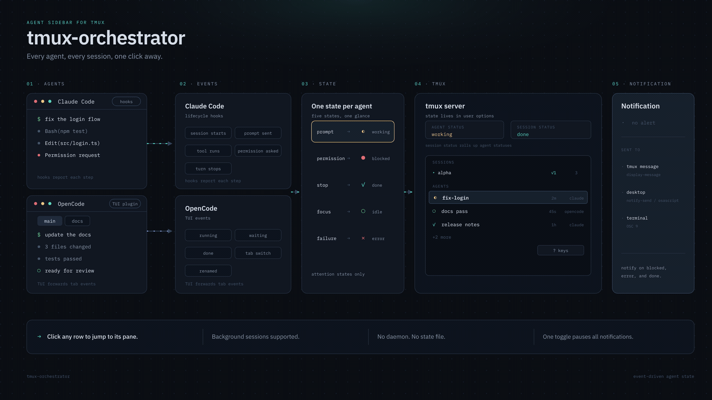

# tmux-orchestrator

A tmux-native sidebar for Claude Code and OpenCode agents. It shows every tmux
session with an agent, the agents in the current session, and switches to the
right session, window, and pane with one click.

State comes from agent lifecycle events, not from screen scraping. The reporter
stores it in tmux pane and session options, so there is no daemon, no state file,
and no external database.

[](docs/diagrams/architecture.gif)

## Install

All installation is user-level. No existing hook JSON or agent configuration
file is rewritten.

### Requirements

- tmux 3.9 or newer (`side-status` is required).
- `jq` for Claude Code hook payloads.
- Claude Code 2.1.x and/or OpenCode 2.x (tested with 2.1.3). OpenCode 1.x is not
  supported.
- `python3` or `nc` with `-U` support, to focus and rename OpenCode tabs and
  rename Claude Code agents.
- Optional, for desktop notifications: `notify-send` on Linux or `osascript` on
  macOS.

### tmux

Install with [TPM](https://github.com/tmux-plugins/tpm): add the
plugin to your tmux configuration, then press `prefix + I` (`prefix + U`
updates it).

```tmux
set -g @plugin 'grota/tmux-orchestrator'
```

### Claude Code

Add this repository as a marketplace and install the plugin,
then enable it in `/plugin` if needed. Sessions started afterwards are tracked.

```text
/plugin marketplace add grota/tmux-orchestrator
/plugin install tmux-orchestrator@tmux-orchestrator
```

### OpenCode

Nothing to do: the tmux plugin links the OpenCode adapter when
OpenCode is installed. Restart OpenCode after the first install.

## Usage

### Sidebar

Every agent you run, in every tmux session, on one always-visible strip. No
more hunting through windows to find out who is done, who is stuck and who is
still thinking: one glance tells you. Toggle it with `prefix + O`, drag its
border to make room, double-click the border to snap it back.

- **Session rows** roll up their agents into the single most urgent state, and
  count who is blocked (`◉2`), failed (`×1`) or done (`✓1`). `▸` marks where
  you are.
- **Agent rows** show the state, the name, the kind (`claude` or `opencode`)
  and how long the agent has been in that state (`3m12s`), so the agent that
  has been waiting longest stands out.
- **Subagents and background work** are visible too: a Claude Code agent with
  subagents shows their state and count (`✓ ●2`), and its background tasks add
  a blue `·` and their count (`·2`).
- **Every OpenCode tab** is its own agent. A busy pane shows nine and folds the
  rest into a `+N more` row.
- **Click** a session to jump to it, or an agent to land on its exact pane
  and OpenCode tab.
- **Double-click** to rename: a session row renames the tmux session, an agent
  row renames the agent in Claude Code or OpenCode itself.
- **Window names** follow the agent in the window's active pane, cut to 20
  characters, and go back to the command when the agent exits.
- **`? keys`**, the last row, lists every key binding the plugin knows about.

| State   | Icon | Colour | Meaning                                    |
| ------- | ---- | ------ | ------------------------------------------ |
| working | `●`  | yellow | running a turn                             |
| blocked | `◉`  | red    | waiting for a permission or an answer      |
| error   | `×`  | red    | the turn failed; stays until next activity |
| done    | `✓`  | teal   | turn finished; clears when you view it     |
| idle    | `○`  | green  | nothing to do                              |
| unknown | `·`  | grey   | no state yet                               |

### Attention key

One key to triage everything. Each press takes you straight to the next agent
that needs you, across all tmux sessions and terminal windows: blocked ones
first, then failed, then finished, the longest waiting first. Once those are
handled it keeps going through every other agent, then starts over. An agent
that starts needing you jumps the queue, so you never miss it. Pick the key in
[Options](#options); it is not bound until you do.

### Notifications

When an agent gets blocked, fails or finishes, you hear about it, unless you
are already looking at it.

- **Desktop notifications** reach you wherever you are. Click one and you land
  on the agent; with a raise command set (see [Options](#options)), its
  terminal window comes forward too. Each agent keeps at most one notification
  on screen: a new one replaces the old one instead of piling up.
- **Inside tmux, the sidebar is your notification.** Nothing flashes over your
  status line: the change is already on the sidebar, and it stays there until
  you deal with it.
- **Terminal notifications** (OSC 9) work even over SSH, in terminals that
  support them.

Need some quiet? Pause every notification with one command (see
[Commands](#commands)); the sidebar keeps updating.

## Options

Set options above the line that runs TPM (`run '~/.tmux/plugins/tpm/tpm'`). The
ones marked _live_ can also be changed later and apply at once.

| Option                                     | Default      | Description                                                                                    |
| ------------------------------------------ | ------------ | ---------------------------------------------------------------------------------------------- |
| `@tmux-orchestrator-side`                  | `left`       | Sidebar side: `left` or `right`.                                                               |
| `@tmux-orchestrator-width`                 | `28`         | Sidebar width in columns.                                                                      |
| `@tmux-orchestrator-toggle-key`            | `O`          | Key, after the prefix, that shows and hides the sidebar.                                       |
| `@tmux-orchestrator-name-max-chars`        | `wrap`       | _Live._ `wrap` long names over up to four lines, `nowrap` to cut them, or a maximum length.    |
| `@tmux-orchestrator-focus-style`           | `underlined` | _Live._ How the agent you are viewing is marked: `underlined`, `bold` or `none`.               |
| `@tmux-orchestrator-time`                  | `on`         | _Live._ `off` hides the state time.                                                            |
| `@tmux-orchestrator-time-on-view`          | `keep`       | _Live._ `reset` restarts a `done` agent's time when you view it.                               |
| `@tmux-orchestrator-window-name`           | `on`         | `off` keeps agent names out of windows; `force` names them when your format lacks the command. |
| `@tmux-orchestrator-attention-key`         | unset        | Key that goes to the next agent needing you. Not bound unless set.                             |
| `@tmux-orchestrator-attention-table`       | `prefix`     | Key table of the attention key; `root` binds it without the prefix.                            |
| `@tmux-orchestrator-notify-desktop`        | `on`         | _Live._ Desktop notifications (`notify-send` or `osascript`).                                  |
| `@tmux-orchestrator-notify-terminal`       | `off`        | _Live._ An OSC 9 notification shown by the terminal (Ghostty, iTerm2, WezTerm), even over SSH. |
| `@tmux-orchestrator-notify-timeout`        | `5`          | _Live._ Seconds a desktop notification stays open and can be clicked.                          |
| `@tmux-orchestrator-raise-command`         | unset        | _Live._ Shell command that brings the agent's terminal window forward.                         |
| `@tmux-orchestrator-focus-events`          | `on`         | `off` leaves tmux's `focus-events` alone; agents in background windows then do not notify.     |
| `@tmux-orchestrator-opencode-auto-install` | `on`         | `off` stops the plugin from linking the OpenCode adapter.                                      |

Examples:

```tmux
set -g @tmux-orchestrator-attention-key M-a
set -g @tmux-orchestrator-attention-table root   # no prefix needed
set -g @tmux-orchestrator-raise-command '~/.tmux/plugins/tmux-orchestrator/examples/raise-command-niri.sh'
```

`examples/raise-command-niri.sh` raises the terminal window on niri.

The plugin never overwrites a key binding of yours: if the toggle or attention
key is taken, it keeps your binding and tells you.

## Commands

The plugin runs the reporter for you; these commands are for bindings, scripts
and recovery. The examples call the reporter `tmux-orchestrator`:

```sh
alias tmux-orchestrator="$(tmux show-options -gv @tmux-orchestrator-reporter)"
```

| Command                                  | What it does                                                                           |
| ---------------------------------------- | -------------------------------------------------------------------------------------- |
| `notify pause`, `resume`, `toggle`       | Stop or restart all notifications. The sidebar keeps updating; pause survives reloads. |
| `notify status`                          | Show whether notifications are paused and each channel's setting.                      |
| `focus-agent --pane ID`                  | Go to an agent, as a notification click does.                                          |
| `toggle`                                 | Show or hide the sidebar.                                                              |
| `reconcile`                              | Recompute every session summary after a crash or stale state.                          |
| `gc`                                     | Remove agents of panes whose process exited (`remain-on-exit`).                        |
| `cleanup`                                | Remove all agent options and hooks from the running server.                            |
| `install opencode`, `uninstall opencode` | Link or unlink the OpenCode adapter by hand.                                           |

Example bindings:

```tmux
bind-key N run-shell -b '#{@tmux-orchestrator-reporter} notify pause'
bind-key M run-shell -b '#{@tmux-orchestrator-reporter} notify resume'
```

## How it works

Details for advanced users.

### Claude Code events

The plugin forwards these hooks to the reporter, which maps them:

| Event                                                  | State                               |
| ------------------------------------------------------ | ----------------------------------- |
| `SessionStart`                                         | `idle`                              |
| `UserPromptSubmit`, `PostToolUse`, `ElicitationResult` | `working`                           |
| `PreToolUse`                                           | `working`                           |
| `PreToolUse` for `AskUserQuestion` or `ExitPlanMode`   | `blocked`                           |
| `PermissionRequest`, `Elicitation`                     | `blocked`                           |
| `Stop`                                                 | `done` after work, otherwise `idle` |
| `StopFailure`                                          | `error`                             |
| interrupt (Esc), read from the session status          | `idle`                              |
| `SubagentStart`                                        | lists the subagent                  |
| `SessionEnd`                                           | removed                             |

- Subagent tool calls and permission requests count toward the main agent. A
  waiting agent stays `blocked` until the one that waits calls a tool again,
  ends, or a new turn starts. Parallel tool calls cannot be told apart, so one
  finishing clears a wait raised by another.
- Subagents are listed from their first event until `SubagentStop`. One silent
  for 30 minutes is dropped. When the last one ends, the agent takes its main
  thread's state.
- Background tasks (`Bash` with `run_in_background`, or `Monitor`) are added at
  launch. Each `Stop` hook lists the tasks still running, and the sidebar takes
  that list. A task no `Stop` lists for six hours is dropped. Tasks never change
  the state or notify.
- Claude Code sends no hook for Esc. While a turn runs, a watcher reads the
  session's status from Claude Code's undocumented session registry every 2
  seconds and moves the agent to `idle` when the turn was interrupted (SPEC.md
  D6).
- The agent name is the session title, else the working-directory basename,
  refreshed from `claude agents --json`.
- The last hook is stored in the pane option `@agent_1_event`, for example
  `claude:StopFailure:rate_limit`.
- A background session shown with `claude attach <id|name>` is the agent of
  that pane while the pane shows it. Events from a session no pane shows are
  ignored.

### OpenCode events

The adapter runs in the OpenCode TUI and reports each open tab as its own agent:

- `session.execution.started`, `permission.replied`, `form.replied` and
  `form.cancelled` → `working`.
- `permission.asked` and `form.created` → `blocked`.
- `session.execution.succeeded` → `done` after work, otherwise `idle`.
- `session.execution.failed` → `error`.
- `session.execution.interrupted` → `idle`.
- `session.renamed` → a new agent name.

Opening a tab adds an agent, closing it removes the agent, and exiting the TUI
removes all of the pane's agents. Subagents run as child sessions and count
toward their root tab. The reporter focuses and renames tabs over a Unix socket
the TUI opens in `tmux-orchestrator-<uid>/` under `$XDG_RUNTIME_DIR` (or the
system temporary directory).

### Notifications

- Notification text is `◉ Agent blocked: fix-login`. Kind and location are
  left out.
- Nothing is sent while any client views the agent: its pane, and for OpenCode
  its active tab.
- The plugin turns on tmux's `focus-events`, so a terminal window without focus
  does not count as viewing. The terminal must report focus changes (Ghostty,
  kitty, WezTerm, iTerm2 and foot do).
- A click on a `notify-send` notification brings one client to the agent: the
  one showing its window, else one in its tmux session, else the most recently
  active one. The raise command then runs with `TMUX_ORCHESTRATOR_PANE`,
  `TMUX_ORCHESTRATOR_SESSION`, `TMUX_ORCHESTRATOR_CLIENT`,
  `TMUX_ORCHESTRATOR_CLIENT_PID` and `TMUX_ORCHESTRATOR_CLIENT_TTY` set.
- `osascript` notifications on macOS cannot be clicked.
- The terminal channel is off by default because those terminals turn it into a
  system notification too, so with desktop on you would see each one twice.

### Sidebar details

- Viewing a `done` agent clears it to `idle`; its time keeps running unless
  `@tmux-orchestrator-time-on-view` is `reset`.
- When rows do not fit, the list keeps the focused agent visible.
- The plugin rebinds `MouseDown1Status` and `DoubleClick1Status`, replacing any
  bindings of yours for them.
- The sidebar's on/off state is kept in `@tmux-orchestrator-enabled`, so a
  reload does not bring back a hidden sidebar.
- The adapters find the reporter through the global option
  `@tmux-orchestrator-reporter`; the tmux plugin holds its only copy.

## Development

Work from a git checkout, here `/path/to/checkout`. Load the tmux plugin from it
instead of TPM, and start Claude Code with the checkout's plugin:

```tmux
run-shell '/path/to/checkout/tmux-orchestrator.tmux'
```

```sh
claude --plugin-dir /path/to/checkout/plugins/claude
```

The adapters use the reporter of the loaded tmux plugin copy. After switching
between TPM and a checkout, reload tmux; running agents use the new reporter on
their next event, and OpenCode needs a restart. An adapter newer than the loaded
reporter is ignored, and tmux shows a one-time message.

Run the tests with `bash tests/<name>-test.sh` for each shell suite and
`node --test tests/` for the OpenCode adapter. They start private tmux servers
and do not touch the running one.

Some features rely on undocumented Claude Code and OpenCode internals. After
updating either, run the contract tests against the installed versions:

```sh
bash tests/contract/claude-test.sh
bash tests/contract/opencode-test.sh
```

Each starts a real agent in a private tmux server and needs no model.
`TMUX_ORCHESTRATOR_CONTRACT_TURN=1` also interrupts one Haiku turn in the Claude
test. The Claude test needs the checkout to be a folder Claude already trusts.

## Known limitations

- tmux 3.9 or newer is required; there is no fallback sidebar.
- A crashed agent that never sends `SessionEnd` can leave a stale row until
  `reconcile`, `gc`, or the pane closes.
- Claude Code interrupts and agent renames use undocumented Claude Code
  internals (SPEC.md D6, D9). If an update changes them, interrupted agents stay
  `working` and renames fail; `tests/contract/claude-test.sh` detects it.
- `done` clears only on a pane, window or session selection, so an agent that
  finishes in the pane you are looking at stays `done` until you select
  something. An OpenCode agent on a background tab stays `done` until its tab
  becomes active.
- Notifications omit location, so two agents with the same name are ambiguous.
- A Claude Code background session is tracked only while a pane shows it with
  `claude attach`, and only on the default tmux server.
- A long `? keys` panel hides the agent list until you close it.
- State disappears when the tmux server exits.
- A desktop notifier that accepts a notification and drops it cannot be
  detected.
